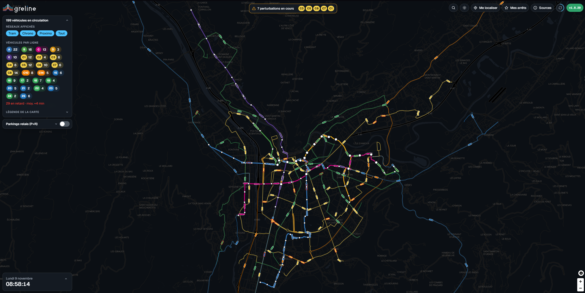
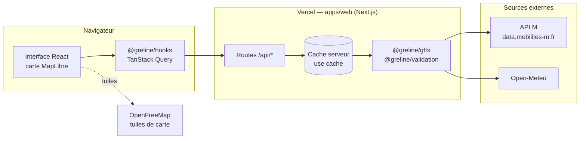
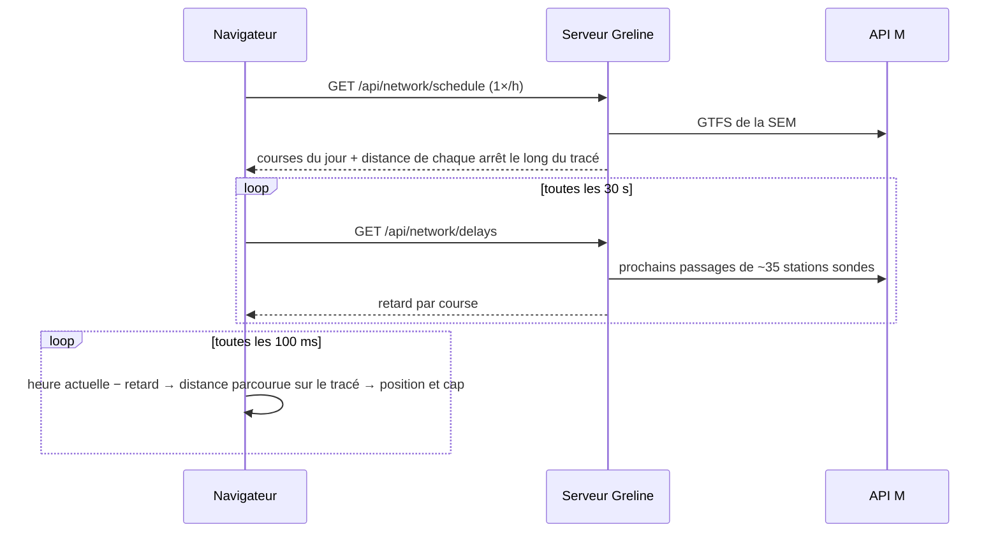
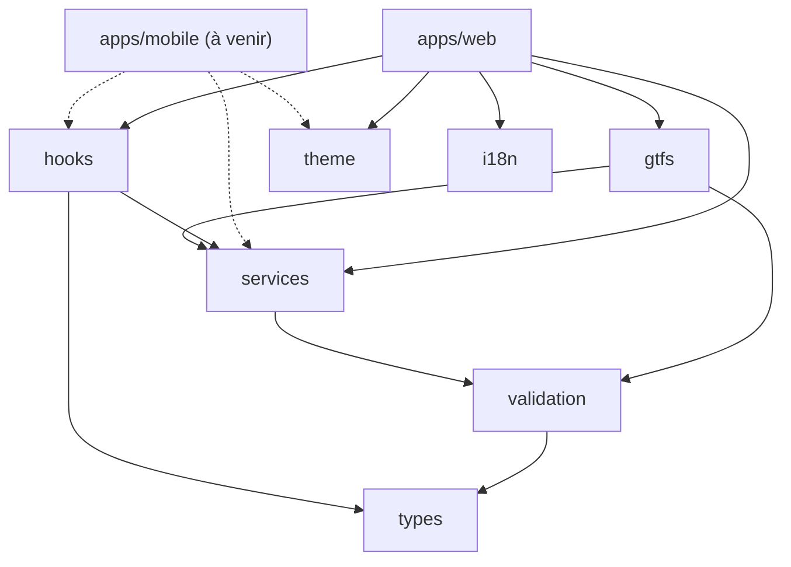

# Greline

Les trams et les bus de Grenoble en temps réel, sur une carte.

[](https://greline.app)


[](LICENSE)

[](https://greline.app)

Ouvrez [greline.app](https://greline.app) : chaque tram et chaque bus de la SEM avance sur son vrai tracé. Cliquez sur un arrêt pour voir les prochains passages ; si une ligne est coupée, le tronçon s'affiche en pointillés.

> Greline est un projet personnel, sans lien avec la Métropole, M ou la SEMITAG. Les données viennent de « M – Mobilités de l'agglomération grenobloise », sous licence ODbL.

## Pourquoi ce projet

Les applications officielles disent bien quand passe le prochain tram. Elles ne donnent pas de vue d'ensemble : où sont les rames en ce moment, quelle ligne est en retard, qu'est-ce qui est coupé.

L'idée de départ venait des jeux de gestion de métro, où l'on voit tout le réseau vivre d'un coup d'œil. Je voulais la même chose avec de vraies données.

C'est aussi un terrain de jeu technique. L'API open data de M est riche, mais pleine de pièges :
- pas de position GPS des véhicules ;
- des fiches horaires vides la nuit ;
- un en-tête `origin` obligatoire, faute de quoi elle refuse de répondre.

Une bonne partie du travail a consisté à composer avec ces limites.

## Ce que fait Greline

- Affiche les 5 lignes de tram, les Chrono et les Proximo sur une carte MapLibre, en thème clair ou sombre.
- Anime chaque véhicule sur son tracé, orienté dans le sens de la marche, avec un contour rouge au-delà de 2 minutes de retard.
- Donne les prochains passages de n'importe quel arrêt, par ligne et par direction, rafraîchis toutes les 15 secondes.
- Montre les perturbations du jour dans un bandeau, et sur la carte quand le texte officiel permet de retrouver le tronçon.
- Garde vos arrêts favoris et votre trajet habituel sur l'appareil, sans compte.
- Trouve les arrêts autour de vous.
- Résume la journée : heure, météo, soleil, lune et état général du trafic.

## Comment ça marche

### Le principe

Le navigateur ne parle jamais directement à l'API M. Il passe par les routes `/api/*` de Greline. Le serveur va chercher les données, les valide avec Zod et les garde en cache. Si M change un format demain, il n'y a qu'un seul endroit à corriger.



Chaque route a son propre rythme, selon la vitesse à laquelle ses données changent :

| Route | Ce qu'elle renvoie | Cache serveur | Rafraîchissement côté client |
|---|---|---|---|
| `/api/network` | Lignes, arrêts, tracés, sens de circulation | 24 h | chargé avec la page |
| `/api/network/schedule?network=` | Courses du jour d'un réseau, tirées du GTFS (~6,5 Mo) | 6 h | toutes les heures |
| `/api/network/delays` | Retard mesuré de chaque course | 30 s | toutes les 30 s |
| `/api/stops/[id]/departures` | Prochains passages d'un arrêt | 15 s | toutes les 15 s |
| `/api/disruptions` | Perturbations en cours et du jour | 2 min | toutes les 2 min |
| `/api/weather` | Météo et soleil à Grenoble (Open-Meteo) | 15 min | toutes les 15 min |

Quand l'API M flanche, les requêtes sont retentées deux fois. Si elle ne répond toujours pas, la page le dit et se recharge seule 30 secondes plus tard.

### Faire rouler des trams sans GPS

C'est le cœur du projet. L'API M ne donne pas la position des véhicules, seulement les prochains passages arrêt par arrêt. Greline reconstitue donc les positions :



1. Le GTFS donne l'horaire théorique de chaque course à chaque arrêt, et la position de chaque arrêt le long du tracé.
2. Toutes les 30 secondes, le serveur interroge une trentaine de stations choisies, de préférence des pôles de correspondance. Il en déduit le retard de chaque course.
3. Le navigateur fait le reste : à partir de l'heure et du retard, il calcule la distance parcourue sur le tracé, puis la position et le cap du véhicule.

Ce n'est pas du GPS : entre deux mesures, un véhicule peut être un peu en avance ou en retard sur sa vraie position. Ce code vit dans `packages/services` (`vehicles.ts`, `geo.ts`) et il est testé.

## La stack

| Couche | Outil | Pourquoi ce choix |
|---|---|---|
| Langage | TypeScript, en mode strict | Un seul langage du serveur à l'interface |
| Web et API | Next.js 16 (App Router, Cache Components) | Pages et routes API au même endroit, cache déclaratif avec `"use cache"` |
| Interface | React 19, Tailwind CSS 4 | Simple, et le thème passe par des variables CSS |
| Carte | MapLibre GL via `react-map-gl` | Open source, lignes et véhicules dessinés par le GPU |
| Données côté client | TanStack Query 5 | Cache et rafraîchissement, en pause quand l'onglet est caché |
| Validation | Zod 4 | Rien d'extérieur n'entre sans être vérifié |
| Tests | Vitest | Sur des extraits réels de l'API M |
| Monorepo | pnpm workspaces | Le code partagé est importé en source, sans étape de build |
| Hébergement | Vercel | Un déploiement à chaque push sur `main` |

Une app mobile Expo est prévue. Elle réutilisera les packages partagés.

## L'organisation du code

```
greline/
├── apps/
│   ├── web/              le site et les routes API (Next.js)
│   └── mobile/           l'app iOS / Android (Expo), pas encore commencée
├── packages/
│   ├── types/            les types métier : Line, Stop, Departure, Disruption…
│   ├── validation/       les schémas Zod
│   ├── gtfs/             tout ce qui parle à l'API M, côté serveur
│   ├── services/         la logique pure : géométrie, positions, trafic, favoris
│   ├── hooks/            les hooks React partagés
│   ├── theme/            couleurs et tailles
│   ├── i18n/             les textes de l'interface
│   └── tsconfig/         la config TypeScript commune
├── docs/decisions/       les choix d'architecture, un fichier par décision
└── scripts/guardrails/   les vérifications des hooks git et de la CI
```



La règle : on partage la logique, pas l'interface. Les calculs, les types et les hooks sont écrits une fois. Chaque app garde ses propres composants, pour être pensée pour sa plateforme. Pour que ça tienne, les packages n'importent jamais `next`, `react-dom`, `react-native` ni `expo`, et un hook git le vérifie.

Les choix importants (fond de carte, bus, perturbations…) sont expliqués dans [`docs/decisions/`](docs/decisions).

## Lancer le projet

Il faut Node.js 20.19 ou plus récent (24 recommandé, voir `.nvmrc`) et pnpm 10 ou plus (`corepack enable pnpm`).

```bash
git clone https://github.com/Feareis/greline.git
cd greline
pnpm install      # installe tout et active les hooks git
pnpm dev:web      # http://localhost:3000
```

Pas de clé d'API à configurer : l'API M, Open-Meteo et OpenFreeMap sont publiques.

Les autres commandes utiles :

```bash
pnpm check        # garde-fous, typecheck et tests
pnpm lint         # ESLint
pnpm build:web    # build de production
```

## Contribuer

Un bug, une idée, une ligne qui s'affiche mal ? Ouvrez une issue, même courte. Pour du code :

1. Pour un changement important, ouvrez d'abord une issue, qu'on en discute.
2. Créez une branche `type/description` (par exemple `feat/night-mode` ou `fix/departures-midnight`).
3. Ajoutez des tests si vous touchez à la logique dans `packages/`.
4. Lancez `pnpm check && pnpm lint` avant de pousser.
5. Ouvrez une pull request vers `main` en expliquant ce qui change et pourquoi.

Quelques conventions, vérifiées automatiquement par les hooks git et la CI :

- Le code, les commentaires et les messages de commit sont en anglais. Les textes de l'interface sont en français et vivent uniquement dans `packages/i18n/src/locales/`.
- Les commits suivent [Conventional Commits](https://www.conventionalcommits.org/fr/), avec un titre de 72 caractères au plus : `feat(web): add night mode`.
- Pas de ligne `Co-authored-by` ni de signature d'outil dans les commits.
- Le navigateur n'appelle jamais l'API M directement, et toute donnée externe passe par un schéma Zod.
- On ne commite pas de `.env`, on n'utilise pas `--no-verify`, et on ne réécrit pas l'historique de `main`.
- Pas de logos M, TAG ou SEMITAG : le projet n'est pas officiel et ne doit pas en avoir l'air.

La version affichée sur le site vient de `apps/web/package.json` et se lit `1.étape.commits` : le chiffre du milieu est l'étape en cours, le dernier compte les commits qui touchent le site (`apps/web` ou `packages`) depuis le début de l'étape. Le hook pre-commit l'incrémente tout seul. Pour une nouvelle étape, on passe la version à `1.(étape).0` à la main. Pour un `git commit --amend`, on définit `GRELINE_KEEP_VERSION=1` afin de ne pas compter deux fois le même commit. L'app mobile a sa propre version, en `0.x` tant qu'elle n'est pas publiée.

## Où en est le projet

Le projet avance par étapes. Chacune donne une version utilisable.

| Version | Contenu | |
|---|---|---|
| 1.1 | Les lignes de tram et leurs stations | fait |
| 1.2 | Les prochains passages en temps réel | fait |
| 1.3 | Les rames animées, la vraie carte, la géolocalisation | fait |
| 1.4 | Le design, le thème clair/sombre, les infos du jour | fait |
| 1.5 | Les bus Chrono et Proximo | fait |
| 1.6 | Les perturbations | fait |
| 1.7 | Les favoris et le trajet habituel | fait |
| 1.8 | La recherche d'itinéraire avec correspondances | prochaine étape |
| mobile 1.0 | L'app mobile et les notifications de perturbation | plus tard |

Dans un coin de ma tête aussi :
- épaissir les lignes selon leur fréquence ;
- rejouer une journée en accéléré ;
- signaler les arrêts accessibles en fauteuil ;
- ajouter les autres transporteurs du réseau M.

## Crédits

- Données de transport : M – Mobilités de l'agglomération grenobloise, licence [ODbL](https://opendatacommons.org/licenses/odbl/).
- Fond de carte : © contributeurs [OpenStreetMap](https://www.openstreetmap.org/copyright), tuiles [OpenFreeMap](https://openfreemap.org).
- Météo : [Open-Meteo](https://open-meteo.com).
- Code : licence [MIT](LICENSE). Les données restent sous leur propre licence (ODbL pour M et OpenStreetMap).
