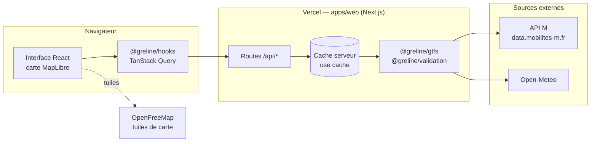
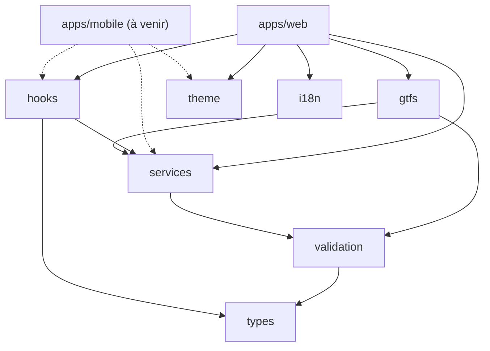
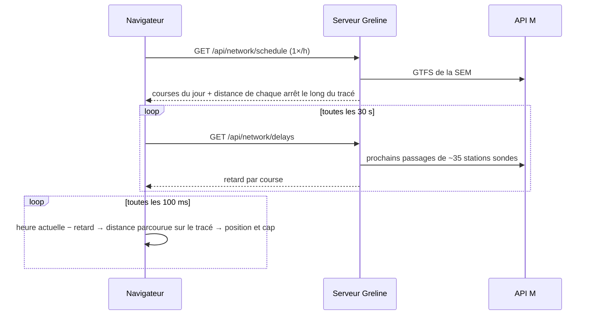

# Greline

**Le réseau de transports de Grenoble en temps réel, sur une carte vivante.**

[](https://greline.app)


Greline affiche les trams et les bus de la SEM (Grenoble) **qui roulent en direct** sur une carte, avec les prochains passages de chaque arrêt, les perturbations, la météo du jour et vos arrêts favoris.

> ⚠️ **Projet indépendant et non officiel.** Sans lien avec la Métropole, M ou la SEMITAG, dont il n'utilise pas les logos. Données : « M – Mobilités de l'agglomération grenobloise », licence ODbL.

---

## Sommaire

- [Le projet](#le-projet) — qui, quoi, pourquoi
- [Fonctionnalités](#fonctionnalités)
- [Stack technique](#stack-technique)
- [Architecture](#architecture)
- [Comment ça marche](#comment-ça-marche) — flux de données, cache, positions des rames
- [Démarrer en local](#démarrer-en-local)
- [Contribuer](#contribuer)
- [Feuille de route](#feuille-de-route)
- [Crédits et licence](#crédits-et-licence)

---

## Le projet

### Quoi

Une carte plein écran du réseau grenoblois où l'on voit :

- les **5 lignes de tram** (A à E), les **Chrono** et les **Proximo**, sur leur vrai tracé ;
- chaque **rame et chaque bus en mouvement**, positionné à partir des horaires du jour et corrigé par le retard mesuré en temps réel ;
- les **prochains départs** de n'importe quel arrêt, par ligne et par direction ;
- les **perturbations** officielles, avec le tronçon coupé tracé sur la carte.

### Pourquoi

Les applications officielles répondent à la question « quand passe mon prochain tram ? », mais pas à « que se passe-t-il sur le réseau, là, maintenant ? ». Greline part d'une idée simple : **rendre le réseau visible**, comme dans un jeu de gestion de métro, avec des lignes colorées et des véhicules qui bougent.

C'est aussi un projet d'ingénierie assumé : prendre une API open data réelle (avec ses limites, ses trous et ses surprises) et en tirer un produit **fiable, typé, testé et documenté**, livré prototype par prototype.

### Qui

Conçu et développé par **[Feareis](https://github.com/Feareis)**.

### Comment

- **Une API open data, jamais appelée par le navigateur** : le serveur Next.js relaie l'API M, valide chaque réponse avec Zod et la met en cache. Le client ne parle qu'à notre propre API.
- **La logique dans des packages partagés** (types, validation, calculs, hooks), testée avec Vitest et prête pour la future app mobile Expo.
- **Des livraisons courtes** : un prototype utilisable par version, chaque choix important consigné dans [`docs/decisions/`](docs/decisions).

---

## Fonctionnalités

| | Fonctionnalité | Détail |
|---|---|---|
| 🗺️ | Carte réelle | MapLibre GL + fond OpenStreetMap (OpenFreeMap), thème clair ou sombre |
| 🚋 | Véhicules animés | Trams et bus en SVG, orientés dans le sens de la marche, contour rouge au-delà de 2 min de retard |
| ⏱️ | Prochains passages | Par ligne et par direction, temps réel ou théorique, rafraîchis toutes les 15 s |
| 🚌 | Bus | Lignes Chrono et Proximo, filtres Tram / Chrono / Proximo / Tout |
| ⚠️ | Perturbations | Bandeau du jour, tronçon coupé ou perturbé en pointillés sur la carte |
| ⭐ | Favoris et trajet | Arrêts favoris et trajet habituel (lignes directes), enregistrés sur l'appareil, sans compte |
| 📍 | Me localiser | Arrêts les plus proches de soi |
| 🌤️ | Infos du jour | Heure de Grenoble, météo, lever et coucher du soleil, phase de lune, état global du trafic |

---

## Stack technique

| Couche | Choix | Pourquoi |
|---|---|---|
| Langage | **TypeScript** (strict) | Un seul langage du serveur au client, des contrats de données vérifiés à la compilation |
| Monorepo | **pnpm workspaces** | Packages partagés consommés en source, sans étape de build |
| Web + API | **Next.js 16** (App Router, Cache Components) | Pages et routes API dans la même app, cache serveur déclaratif (`"use cache"`) |
| Interface | **React 19** + **Tailwind CSS 4** | Composants simples, styles utilitaires, thème par variables CSS |
| Carte | **MapLibre GL** via `react-map-gl` | Moteur vectoriel open source, couches GPU pour les lignes et les véhicules |
| Données client | **TanStack Query 5** | Cache, rafraîchissement périodique, pause quand l'onglet est caché |
| Validation | **Zod 4** | Toute donnée externe est validée à l'entrée (API M, Open-Meteo, stockage local) |
| Tests | **Vitest** | Logique métier testée sur des extraits réels de l'API M |
| Mobile (à venir) | **Expo** (React Native) | Réutilise les packages partagés |
| Hébergement | **Vercel** | Déploiement à chaque push sur `main`, domaine `greline.app` |

**Sources de données** : API M (`data.mobilites-m.fr` : lignes, tracés, fiches horaires, GTFS, temps réel, événements), Open-Meteo (météo), OpenFreeMap (tuiles de carte).

---

## Architecture

### Vue d'ensemble



Le navigateur ne contacte jamais l'API M : il ne parle qu'aux routes `/api/*` de Greline (et au serveur de tuiles pour le fond de carte). Si l'API M change de format, une seule couche est à corriger.

### Le monorepo

```
greline/
├── apps/
│   ├── web/              Next.js : site + routes API (/api/*)
│   └── mobile/           Expo : app iOS / Android (à venir)
├── packages/
│   ├── types/            Types métier : Line, Stop, Departure, Disruption…
│   ├── validation/       Schémas Zod : réponses de l'API M et de notre API
│   ├── gtfs/             Accès serveur à l'API M : réseau, GTFS, temps réel, perturbations
│   ├── services/         Logique pure : géométrie, positions des véhicules, trafic, favoris…
│   ├── hooks/            Hooks React partagés (TanStack Query)
│   ├── theme/            Couleurs et tokens de design (valeurs, pas de composants)
│   ├── i18n/             Textes de l'interface (français)
│   └── tsconfig/         Configuration TypeScript commune
├── docs/decisions/       Décisions d'architecture (ADR)
└── scripts/guardrails/   Hooks git et vérifications de la CI
```



**On partage la logique, pas l'interface.** Types, validation, calculs et hooks sont écrits et testés une fois. Les composants visuels restent propres à chaque app, pour qu'elles soient pensées pour leur plateforme (souris et grand écran d'un côté, doigt et gestes natifs de l'autre).

Règles d'architecture, vérifiées par les hooks git :

- `packages/*` n'importe jamais `next`, `react-dom`, `react-native` ni `expo`.
- Ce qui dépend de la plateforme (stockage, géolocalisation…) est **injecté**, jamais importé.
- Une seule version de React dans tout le monorepo, alignée sur le SDK Expo.

---

## Comment ça marche

### Routes API et cache

Chaque route relaie une source externe, valide la réponse avec Zod et la garde en cache serveur. Le client la rafraîchit à son propre rythme.

| Route | Contenu | Source | Cache serveur | Rafraîchi par le client |
|---|---|---|---|---|
| `/api/network` | Lignes, arrêts, tracés, sens de circulation | API M (routes, tracés, fiches horaires) | 24 h | — (rendu avec la page) |
| `/api/network/schedule?network=` | Courses du jour d'un réseau | GTFS de la SEM (~6,5 Mo) | 6 h | toutes les heures |
| `/api/network/delays` | Retard mesuré de chaque course | Temps réel API M (stations sondes) | 30 s | toutes les 30 s |
| `/api/stops/[id]/departures` | Prochains passages d'un arrêt | Temps réel API M | 15 s | toutes les 15 s |
| `/api/disruptions` | Perturbations en cours et du jour | Événements API M | 2 min | toutes les 2 min |
| `/api/weather` | Météo et soleil à Grenoble | Open-Meteo | 15 min | toutes les 15 min |

Les appels à l'API M sont réessayés en cas d'échec passager (erreur réseau, 5xx, 429). Si elle reste muette, la page l'indique et se recharge d'elle-même.

### Positionner les véhicules sans GPS

L'API M ne publie pas la position GPS des véhicules. Greline la **reconstitue** :



1. **Le GTFS** donne, pour chaque course du jour, l'heure de passage à chaque arrêt et la distance de cet arrêt le long du tracé (`shapes.txt`).
2. **Le temps réel** n'existe que par arrêt. Greline interroge une trentaine de **stations sondes**, choisies de préférence parmi les pôles de correspondance, et en déduit le retard de chaque course.
3. **Le navigateur interpole** la position entre deux arrêts (heure − retard → distance sur le tracé → coordonnées et cap). Tout se fait côté client : aucun recalcul serveur par véhicule.

Ces calculs sont dans `packages/services` (`vehicles.ts`, `geo.ts`) et testés unitairement.

### Qualité

- **TypeScript strict** partout, aucun `any` non justifié.
- **Zod à chaque frontière** : une réponse inattendue de l'API M devient une erreur claire, jamais une donnée corrompue affichée.
- **Tests Vitest** sur la logique métier, à partir d'extraits réels de l'API M (`packages/gtfs/src/__fixtures__`).
- **CI GitHub Actions** : garde-fous, typecheck, tests et lint à chaque push et à chaque pull request.

---

## Démarrer en local

**Prérequis :** Node.js ≥ 20.19 (24 recommandé, voir `.nvmrc`) et pnpm ≥ 10 (`corepack enable pnpm`).

```bash
git clone https://github.com/Feareis/greline.git
cd greline
pnpm install          # installe tout et active les hooks git
pnpm dev:web          # site + API sur http://localhost:3000
```

Aucune clé d'API n'est nécessaire : l'API M, Open-Meteo et OpenFreeMap sont publiques.

| Commande | Rôle |
|---|---|
| `pnpm dev:web` | Serveur de développement Next.js |
| `pnpm build:web` | Build de production |
| `pnpm check` | Garde-fous + typecheck + tests |
| `pnpm lint` | ESLint (web et mobile) |
| `pnpm test` | Tests Vitest seuls |

---

## Contribuer

Les contributions sont les bienvenues : bug, idée, correctif ou nouvelle fonctionnalité.

1. **Ouvrir une issue** pour décrire le bug ou proposer l'idée avant de coder une grosse modification.
2. **Créer une branche** nommée `type/description-courte` (par exemple `feat/night-mode`, `fix/departures-midnight`).
3. **Coder** en respectant les règles ci-dessous, avec des tests pour toute logique métier.
4. **Vérifier** avant de pousser :
   ```bash
   pnpm check && pnpm lint
   ```
5. **Ouvrir une pull request** vers `main`, avec une description de ce qui change et pourquoi.

### Règles du projet

| Sujet | Règle |
|---|---|
| Langue | Code, commentaires, commits et docs techniques en **anglais**. Textes de l'interface en français, **uniquement** dans `packages/i18n/src/locales/`. Ce README est en français. |
| Commits | [Conventional Commits](https://www.conventionalcommits.org/fr/) en anglais, à l'impératif, en-tête ≤ 72 caractères : `feat(web): add night mode`. |
| Attribution | Aucune ligne `Co-authored-by` ni signature d'outil dans les commits et les PR. |
| Données | Le client n'appelle jamais l'API M directement. Toute donnée externe passe par un schéma Zod de `@greline/validation`. |
| Architecture | La logique métier va dans `packages/*`, avec ses tests. Les composants visuels restent dans `apps/*`. |
| Décisions | Un choix structurant donne lieu à un court ADR dans `docs/decisions/`. |
| Interdits | `--no-verify`, réécriture de l'historique de `main`, fichiers `.env` commités, logos M / TAG / SEMITAG. |

Ces règles sont **appliquées automatiquement** :

- hook `commit-msg` : format du message, absence d'attribution ;
- hook `pre-commit` : pas de français dans le code hors `locales/`, pas d'import de plateforme dans `packages/*`, pas de `.env` ;
- CI GitHub : revérifie tout, même si un hook a été contourné.

### Versions

Le numéro de version est celui de `apps/web/package.json`, affiché dans le badge du site : **+0.1** à chaque prototype livré, **+0.0.1** à chaque correctif publié.

---

## Feuille de route

| Version | Contenu | État |
|---|---|---|
| v0.1 | Lignes de tram et stations | ✅ |
| v0.2 | Prochains passages en temps réel | ✅ |
| v0.3 | Rames animées, carte géographique, géolocalisation | ✅ |
| v0.4 | Design web, thème clair/sombre, infos du jour | ✅ |
| v0.5 | Bus Chrono et Proximo, filtres | ✅ |
| v0.6 | Perturbations sur la carte et en bandeau | ✅ |
| v0.7 | Arrêts favoris et trajet habituel | ✅ |
| v0.8 | Recherche d'itinéraire avec correspondances | 🔜 |
| v1.0 | App mobile Expo sur les stores, notifications de perturbation | 🗓️ |

Idées en réserve : mode « fréquentation » (épaisseur des lignes selon le nombre de passages), replay d'une journée en accéléré, arrêts accessibles PMR, autres transporteurs du réseau M.

---

## Crédits et licence

- **Données** : M – Mobilités de l'agglomération grenobloise, licence [ODbL](https://opendatacommons.org/licenses/odbl/).
- **Fond de carte** : © contributeurs [OpenStreetMap](https://www.openstreetmap.org/copyright), tuiles [OpenFreeMap](https://openfreemap.org).
- **Météo** : [Open-Meteo](https://open-meteo.com).
- **Code** : licence à définir.

Greline est un projet personnel, indépendant et non officiel.
