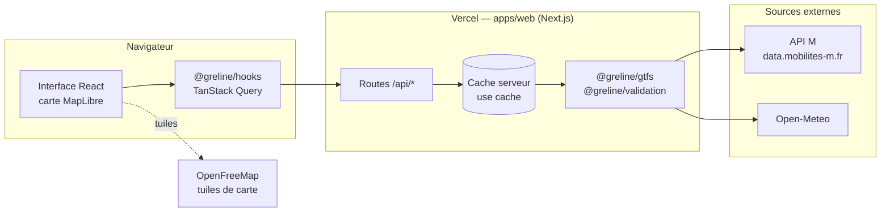
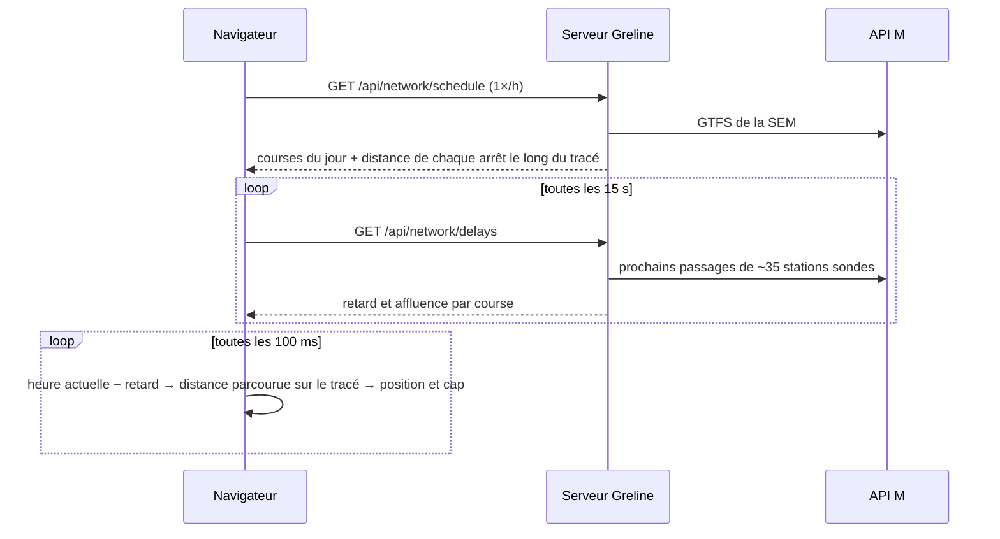
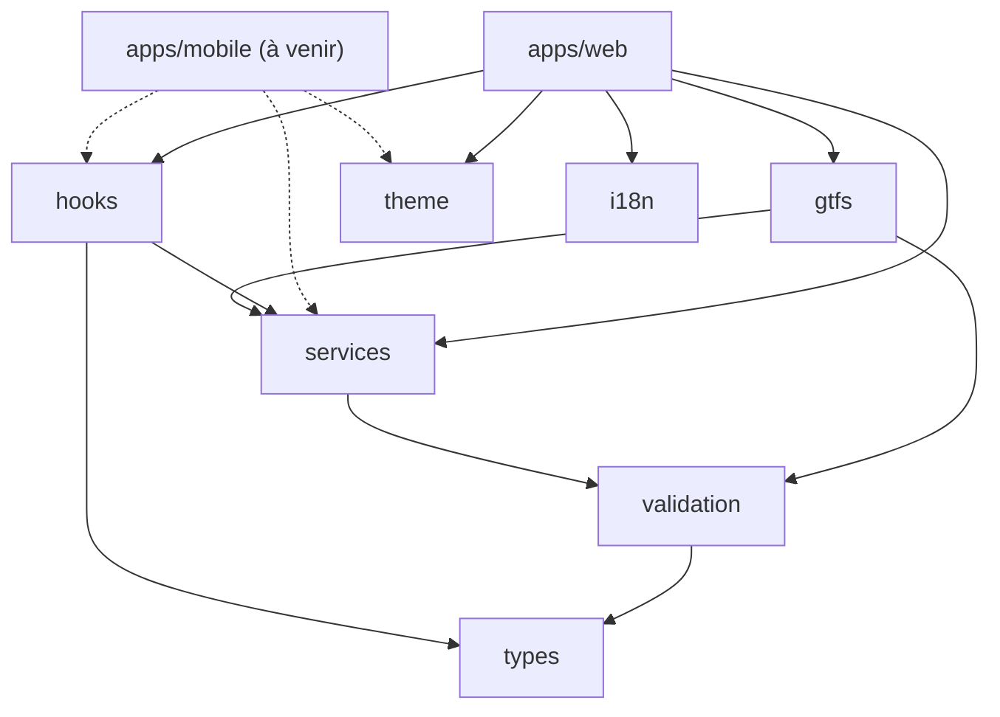

<h1 align="center">
  
</h1>

Les trams et les bus de Grenoble en temps réel, sur une carte.

[](https://greline.app)


[](LICENSE)

[](https://greline.app)

Les applications officielles donnent l'heure du prochain tram, pas la vue d'ensemble : où sont les rames, quelle ligne est en retard, ce qui est coupé. Greline montre tout le réseau d'un coup d'œil, avec les vraies données.

> Projet personnel, sans lien avec la Métropole, M ou la SEMITAG. Données : « M – Mobilités de l'agglomération grenobloise », licence ODbL.

## Ce que fait Greline

- **Carte** : les 5 lignes de tram, les Chrono et les Proximo, en thème clair ou sombre.
- **Véhicules** : chacun avance sur son tracé, avec un contour rouge au-delà de 2 min de retard.
- **Suivi d'un véhicule** : un clic sur un tram ou un bus le suit sur la carte, avec sa direction, son retard, son affluence et ses prochains arrêts.
- **Arrêts** : prochains passages par ligne et direction, toutes les 15 s, avec l'affluence prévue, l'accès en fauteuil roulant, et les arrêts autour de vous.
- **Lignes** : fiche avec véhicules, retards, perturbations et arrêts.
- **Perturbations** : bandeau flottant en haut de la page, tronçons coupés en pointillés sur la carte.
- **Recherche** : arrêts et lignes par leur nom (touche « / »).
- **Itinéraires** : entre deux arrêts ou depuis votre position, avec correspondances.
- **Favoris et trajet habituel** : gardés sur l'appareil, sans compte.
- **Parkings relais** : les P+R proches du réseau, avec les places libres en temps réel pour ceux du tram.
- **Panneau du jour** : heure, météo, qualité de l'air, soleil, lune, retards et perturbations. Il se replie sur la date et l'heure.
- **Mises à jour** : un anneau montre le prochain rafraîchissement, et son panneau le rythme de chaque source.
- **Liens partageables** : l'arrêt, la ligne ou le véhicule suivi est dans l'adresse de la page.
- **App installable** : sur l'écran d'accueil du téléphone ou de l'ordinateur.

## Comment ça marche

L'API open data de M est riche, mais pleine de pièges :
- pas de position GPS des véhicules ;
- des fiches horaires vides la nuit ;
- un en-tête `origin` obligatoire, faute de quoi elle refuse de répondre.

Une bonne partie du travail a consisté à composer avec ces limites.

### Le principe

Le navigateur ne parle jamais directement à l'API M. Il passe par les routes `/api/*` de Greline. Le serveur va chercher les données, les valide avec Zod et les garde en cache. Si M change un format demain, il n'y a qu'un seul endroit à corriger.



Chaque route a son propre rythme, selon la vitesse à laquelle ses données changent. Les réponses sont aussi gardées par le CDN de Vercel, partagées entre tous les visiteurs : c'est pour ça que le site n'a pas de bouton pour forcer une mise à jour.

| Route | Ce qu'elle renvoie | Cache serveur | Rafraîchissement côté client |
|---|---|---|---|
| `/api/network` | Lignes, arrêts, tracés, sens de circulation | 24 h | chargé avec la page |
| `/api/network/schedule?network=` | Courses du jour d'un réseau, tirées du GTFS (~6,5 Mo) | 6 h | toutes les heures |
| `/api/network/delays` | Retard mesuré et affluence prévue de chaque course | 15 s | toutes les 15 s |
| `/api/stops/[id]/departures` | Prochains passages d'un arrêt, avec l'affluence prévue | 15 s | toutes les 15 s |
| `/api/stops/accessibility` | Accès en fauteuil roulant de chaque arrêt, tiré du GTFS | 6 h | une fois par visite |
| `/api/itineraries?from=&to=` | Itinéraires entre deux arrêts, ou depuis une position, en partant maintenant (calculateur de M) | 30 s | toutes les 30 s |
| `/api/park-and-rides` | Parkings relais (P+R) à moins de 500 m d'un arrêt, et leurs places libres quand elles sont comptées | 1 min | toutes les minutes |
| `/api/disruptions` | Perturbations en cours et du jour | 2 min | toutes les 2 min |
| `/api/weather` | Météo et soleil à Grenoble (Open-Meteo) | 15 min | toutes les 15 min |
| `/api/air-quality` | Indice européen de qualité de l'air à Grenoble (Open-Meteo, données CAMS) | 30 min | toutes les 30 min |

Quand l'API M flanche, les requêtes sont retentées deux fois. Si elle ne répond toujours pas, la page le dit et se recharge seule 30 secondes plus tard.

### Faire rouler des trams sans GPS

C'est le cœur du projet. L'API M ne donne pas la position des véhicules, seulement les prochains passages arrêt par arrêt. Greline reconstitue donc les positions :



1. Le GTFS donne l'horaire théorique de chaque course à chaque arrêt, et la position de chaque arrêt le long du tracé.
2. Toutes les 15 secondes, le serveur interroge une trentaine de stations choisies, de préférence des pôles de correspondance. Il en déduit le retard de chaque course.
3. Le navigateur fait le reste : à partir de l'heure et du retard, il calcule la distance parcourue sur le tracé, puis la position et le cap du véhicule.

Ce n'est pas du GPS : entre deux mesures, un véhicule peut être un peu en avance ou en retard sur sa vraie position. Ce code vit dans `packages/services` (`vehicles.ts`, `geo.ts`) et il est testé.

### Suivre un véhicule

Un véhicule est désigné par sa course et son heure de départ (`?vehicle=SEM:32519149@1794182340`), car une même course peut rouler deux jours de suite. Ses prochains arrêts sont lus dans le GTFS, décalés de son retard. La caméra le rejoint, puis se recentre sur lui à chaque image jusqu'à ce qu'on fasse glisser la carte.

L'affluence ne coûte aucune requête de plus : M l'annonce (faible, modérée, forte) dans les prochains passages que les stations sondes demandent déjà pour les retards. C'est une prévision, pas un comptage, et M n'en donne pas la nuit. L'accès en fauteuil roulant vient du même GTFS que les horaires : un arrêt est accessible quand tous ses quais le sont, partiellement quand certains le sont.

## La stack

| Couche | Outil | Pourquoi ce choix |
|---|---|---|
| Langage | TypeScript, en mode strict | Un seul langage du serveur à l'interface |
| Web et API | Next.js 16 (App Router, Cache Components) | Pages et routes API au même endroit, cache déclaratif avec `"use cache"` |
| Interface | React 19, Tailwind CSS 4 | Simple, et le thème passe par des variables CSS |
| Carte | MapLibre GL via `react-map-gl` | Open source, lignes et véhicules dessinés par le GPU |
| Données côté client | TanStack Query 5 | Cache et rafraîchissement, en pause quand l'onglet est caché |
| Validation | Zod 4 | Rien d'extérieur n'entre sans être vérifié |
| Tests | Vitest | Sur des extraits réels de l'API M |
| Monorepo | pnpm workspaces | Le code partagé est importé en source, sans étape de build |
| App installable | Manifeste web, sans service worker | S'ouvre comme une app ; les données en direct n'ont pas de sens hors ligne |
| Hébergement | Vercel | Un déploiement à chaque push sur `main` |

Une app mobile Expo est prévue. Elle réutilisera les packages partagés.

## L'organisation du code

```
greline/
├── apps/
│   ├── web/              le site et les routes API (Next.js)
│   └── mobile/           l'app iOS / Android (Expo), pas encore commencée
├── packages/
│   ├── types/            les types métier : Line, Stop, Departure, Disruption…
│   ├── validation/       les schémas Zod
│   ├── gtfs/             tout ce qui parle à l'API M, côté serveur
│   ├── services/         la logique pure : géométrie, positions, trafic, favoris
│   ├── hooks/            les hooks React partagés
│   ├── theme/            couleurs et tailles
│   ├── i18n/             les textes de l'interface
│   └── tsconfig/         la config TypeScript commune
├── assets/logo/          le logo, le symbole et les icônes (SVG et PNG)
├── docs/decisions/       les choix d'architecture, un fichier par décision
└── scripts/guardrails/   les vérifications des hooks git et de la CI
```



La règle : on partage la logique, pas l'interface. Les calculs, les types et les hooks sont écrits une fois. Chaque app garde ses propres composants, pour être pensée pour sa plateforme. Pour que ça tienne, les packages n'importent jamais `next`, `react-dom`, `react-native` ni `expo`, et un hook git le vérifie.

Les choix importants (fond de carte, bus, perturbations, P+R…) sont expliqués dans [`docs/decisions/`](docs/decisions).

## Lancer le projet

Node.js 20.19+ (24 recommandé) et pnpm 10+ (`corepack enable pnpm`). Aucune clé d'API.

```bash
git clone https://github.com/Feareis/greline.git
cd greline
pnpm install      # installe tout et active les hooks git
pnpm dev:web      # http://localhost:3000
pnpm check        # garde-fous, typecheck et tests
pnpm lint         # ESLint
```

## Contribuer

Ouvrez une issue, même courte. Pour du code : une branche `type/description`, des tests si vous touchez à `packages/`, `pnpm check && pnpm lint`, puis une PR vers `main`.

Les hooks git et la CI vérifient les conventions :
- code et commits en anglais ([Conventional Commits](https://www.conventionalcommits.org/fr/)), textes de l'interface en français dans `packages/i18n/src/locales/` ;
- pas de `Co-authored-by`, de `.env`, de `--no-verify` ni de réécriture de `main` ;
- pas de logos M, TAG ou SEMITAG : le projet n'est pas officiel.

La version du site se lit `1.étape.commits`. Le hook pre-commit compte les commits qui touchent `apps/web` ou `packages` (`GRELINE_KEEP_VERSION=1` pour un `--amend`).

## Où en est le projet

| Version | Contenu | |
|---|---|---|
| 1.1 – 1.3 | Les trams, les passages en temps réel, les rames animées | fait |
| 1.4 – 1.6 | Le design, les bus, les perturbations | fait |
| 1.7 – 1.8 | Les favoris, les itinéraires, le logo, l'app installable, les P+R, le suivi d'un véhicule, l'affluence, l'accès en fauteuil | fait |
| mobile 1.0 | L'app mobile et les notifications de perturbation | prochaine étape |

Plus tard, peut-être : épaissir les lignes selon leur fréquence, rejouer une journée en accéléré, ajouter les autres transporteurs du réseau M.

## Crédits

- Transport : M – Mobilités de l'agglomération grenobloise, licence [ODbL](https://opendatacommons.org/licenses/odbl/).
- Carte : © contributeurs [OpenStreetMap](https://www.openstreetmap.org/copyright), tuiles [OpenFreeMap](https://openfreemap.org).
- Météo et qualité de l'air : [Open-Meteo](https://open-meteo.com), données CAMS (Copernicus).
- Code : licence [MIT](LICENSE).
