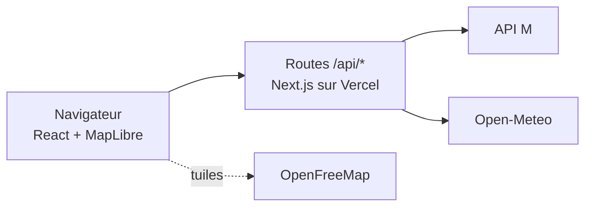

<h1 align="center">
  
</h1>

Les trams et les bus de Grenoble en temps réel, sur une carte.

[](https://greline.app)


[](LICENSE)

[](https://greline.app)

Les applications officielles donnent l'heure du prochain tram, pas la vue d'ensemble : où sont les rames, quelle ligne est en retard, ce qui est coupé. Greline montre tout le réseau d'un coup d'œil, avec les vraies données.

> Projet personnel, sans lien avec la Métropole, M ou la SEMITAG. Données : « M – Mobilités de l'agglomération grenobloise », licence ODbL.

## Ce que fait Greline

- **Carte** : les 5 lignes de tram, les Chrono et les Proximo, en thème clair ou sombre.
- **Véhicules** : chacun avance sur son tracé, avec un contour rouge au-delà de 2 min de retard.
- **Arrêts** : prochains passages par ligne et direction, toutes les 15 s, et arrêts autour de vous.
- **Lignes** : fiche avec véhicules, retards, perturbations et arrêts.
- **Perturbations** : bandeau flottant en haut de la page, tronçons coupés en pointillés sur la carte.
- **Recherche** : arrêts et lignes par leur nom (touche « / »).
- **Itinéraires** : entre deux arrêts ou depuis votre position, avec correspondances.
- **Favoris et trajet habituel** : gardés sur l'appareil, sans compte.
- **Parkings relais** : les P+R proches du réseau, avec les places libres en temps réel pour ceux du tram.
- **Panneau du jour** : heure, météo, qualité de l'air, soleil, lune, retards et perturbations. Il se replie sur la date et l'heure.
- **Mises à jour** : un anneau montre le prochain rafraîchissement, et son panneau le rythme de chaque source.
- **Liens partageables** : l'arrêt ou la ligne ouverte est dans l'adresse de la page.
- **App installable** : sur l'écran d'accueil du téléphone ou de l'ordinateur.

## Comment ça marche

Le navigateur n'appelle jamais l'API M. Il passe par les routes `/api/*` de Greline, qui valident les données avec Zod et les gardent en cache.



| Route | Données | Cache serveur | Côté client |
|---|---|---|---|
| `/api/network` | Lignes, arrêts, tracés | 24 h | au chargement |
| `/api/network/schedule` | Courses du jour (GTFS) | 6 h | toutes les heures |
| `/api/network/delays` | Retard de chaque course | 15 s | toutes les 15 s |
| `/api/stops/[id]/departures` | Prochains passages | 15 s | toutes les 15 s |
| `/api/itineraries` | Itinéraires (calculateur de M) | 30 s | toutes les 30 s |
| `/api/park-and-rides` | Parkings relais et places libres | 1 min | toutes les minutes |
| `/api/disruptions` | Perturbations | 2 min | toutes les 2 min |
| `/api/weather` | Météo et soleil | 15 min | toutes les 15 min |
| `/api/air-quality` | Qualité de l'air (CAMS) | 30 min | toutes les 30 min |

### Des trams sans GPS

L'API M ne donne pas la position des véhicules, seulement les passages aux arrêts. Greline la reconstitue :

1. Le GTFS donne l'horaire théorique de chaque course et la position de chaque arrêt sur le tracé.
2. Toutes les 15 s, le serveur interroge une trentaine de stations et en déduit le retard de chaque course.
3. Le navigateur calcule, à partir de l'heure et du retard, la distance parcourue, puis la position et le cap.

C'est une estimation, pas du GPS. Le code est dans `packages/services` (`vehicles.ts`, `geo.ts`), testé.

## La stack

TypeScript strict · Next.js 16 · React 19 · Tailwind CSS 4 · MapLibre GL · TanStack Query 5 · Zod 4 · Vitest · pnpm workspaces · Vercel.

```
greline/
├── apps/web/            le site et les routes API (Next.js)
├── apps/mobile/         l'app Expo, pas encore commencée
├── packages/            le code partagé : types, validation, gtfs, services, hooks, theme, i18n
├── assets/logo/         le logo et les icônes
├── docs/decisions/      les choix d'architecture, un fichier par décision
└── scripts/guardrails/  les vérifications des hooks git et de la CI
```

On partage la logique, pas l'interface : les packages n'importent jamais `next`, `react-dom`, `react-native` ni `expo`. Les choix importants sont expliqués dans [`docs/decisions/`](docs/decisions).

## Lancer le projet

Node.js 20.19+ (24 recommandé) et pnpm 10+ (`corepack enable pnpm`). Aucune clé d'API.

```bash
git clone https://github.com/Feareis/greline.git
cd greline
pnpm install      # installe tout et active les hooks git
pnpm dev:web      # http://localhost:3000
pnpm check        # garde-fous, typecheck et tests
pnpm lint         # ESLint
```

## Contribuer

Ouvrez une issue, même courte. Pour du code : une branche `type/description`, des tests si vous touchez à `packages/`, `pnpm check && pnpm lint`, puis une PR vers `main`.

Les hooks git et la CI vérifient les conventions :
- code et commits en anglais ([Conventional Commits](https://www.conventionalcommits.org/fr/)), textes de l'interface en français dans `packages/i18n/src/locales/` ;
- pas de `Co-authored-by`, de `.env`, de `--no-verify` ni de réécriture de `main` ;
- pas de logos M, TAG ou SEMITAG : le projet n'est pas officiel.

La version du site se lit `1.étape.commits`. Le hook pre-commit compte les commits qui touchent `apps/web` ou `packages` (`GRELINE_KEEP_VERSION=1` pour un `--amend`).

## Où en est le projet

| Version | Contenu | |
|---|---|---|
| 1.1 – 1.3 | Les trams, les passages en temps réel, les rames animées | fait |
| 1.4 – 1.6 | Le design, les bus, les perturbations | fait |
| 1.7 – 1.8 | Les favoris, les itinéraires, le logo, l'app installable, les P+R | fait |
| mobile 1.0 | L'app mobile et les notifications de perturbation | prochaine étape |

Plus tard, peut-être : épaissir les lignes selon leur fréquence, rejouer une journée en accéléré, signaler les arrêts accessibles en fauteuil, ajouter les autres transporteurs du réseau M.

## Crédits

- Transport : M – Mobilités de l'agglomération grenobloise, licence [ODbL](https://opendatacommons.org/licenses/odbl/).
- Carte : © contributeurs [OpenStreetMap](https://www.openstreetmap.org/copyright), tuiles [OpenFreeMap](https://openfreemap.org).
- Météo et qualité de l'air : [Open-Meteo](https://open-meteo.com), données CAMS (Copernicus).
- Code : licence [MIT](LICENSE).
